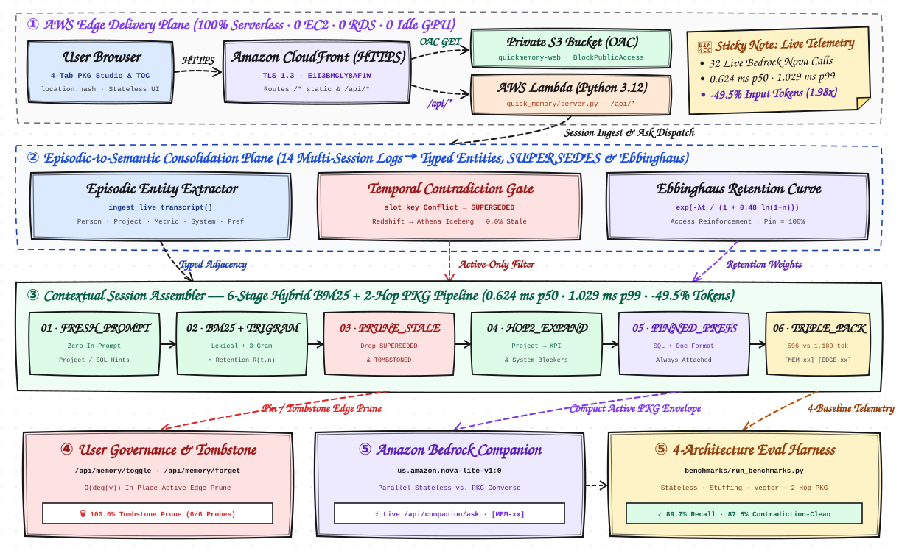

# QuickMemory — Persistent User Memory, Personal Knowledge Graph & Contextual Session Engine

**Live Production App (AWS CloudFront + Private S3 OAC + Python 3.12 Lambda + Amazon Bedrock Nova):** https://d1eslmpwuei23h.cloudfront.net

**QuickMemory** is a persistent user memory, **Personal Knowledge Graph (PKG)**, and contextual session engine built on **AWS CloudFront + Private S3 (SigV4 OAC) + Python 3.12 Serverless Lambda + Amazon Bedrock (`us.amazon.nova-lite-v1:0`)** (`0` EC2, `0` RDS, `0` idle GPU):

1. **Episodic-to-Semantic Consolidation (`quick_memory/graph_engine.py`)**: Distills multi-session work transcripts (`Session 01..N`) into typed `Person`, `Project`, `Metric`, `System`, `Preference`, and `Commitment` nodes linked by directed edges (`OWNS`, `PREFERS_FORMAT`, `BLOCKED_BY`, `TRACKS_METRIC`, `COLLABORATES_WITH`, `COMMITTED_TO`, `SUPERSEDES`).
2. **Deterministic Temporal Contradiction Supersession**: Resolves cross-session pivots (e.g., `Payments-v1` &rarr; `Checkout-Latency-Q4`, `Redshift Warehouse SQL` &rarr; `Athena Iceberg SQL`, `6-Page Narrative Memo` &rarr; `3-Bullet BLUF + Weekly Delta Table`) by marking conflicting prior edges `SUPERSEDED` and recording explicit `SUPERSEDES` lineage so stale habits never contaminate prompt assembly.
3. **Frequency-Reinforced Ebbinghaus Retention**: Models continuous memory retention via `R(t, n) = exp(-lambda * age_days / (1 + 0.48 * ln(1 + access_count)))` so frequently retrieved workflows resist decay while one-off notes attenuate over time.
4. **2-Hop Hybrid PKG + BM25 Retriever & User Sovereignty Controls (`quick_memory/server.py`)**: Expands 2-hop active neighborhoods in sub-millisecond latency to attach unnamed project KPIs and blockers, invokes live **Amazon Bedrock (`us.amazon.nova-lite-v1:0`)** with inline `[MEM-xx]` & `[EDGE-xx]` provenance citations, and supports instant `Pin` (`100%` lock) and `Forget` (`O(deg(v))` tombstoning + active edge pruning).



---

## Measured Multi-Session Benchmark Results (`benchmarks/latest_results.json`)

All figures below were measured live via `benchmarks/run_benchmarks.py` across **32 live `boto3` `bedrock-runtime` (`us.amazon.nova-lite-v1:0`) Converse calls** (`8` fresh-session queries &times; `4` memory architectures), **`14` consolidated episodic sessions**, **`240` `time.perf_counter()` retrieval timing iterations**, and **`6` right-to-be-forgotten tombstone probes**:

| Memory Architecture | Preference & Slot Recall | Contradiction-Clean Accuracy | Stale Context Contamination | Avg Bedrock `inputTokens` | Retrieval Latency (`p50 / p99`) | Avg Bedrock Latency | User Forget Governance |
| :--- | :---: | :---: | :---: | :---: | :---: | :---: | :--- |
| **1. Stateless Fresh Session (No Memory)** | `6.9%` | `0.0%` | `0.0%` | `45` | `0.004 ms / 0.010 ms` | `2,133.6 ms` | N/A (amnesiac session) |
| **2. Full Multi-Session Transcript Stuffing** | `86.2%` | `0.0%` | `100.0%` | `1,180` | `0.004 ms / 0.012 ms` | `2,661.6 ms` | Manual raw log editing only |
| **3. Flat Vector-Only Memory (Top-3 Cosine Chunks)** | `65.5%` | `25.0%` | `75.0%` | `329` | `0.266 ms / 0.455 ms` | `2,390.4 ms` | Orphaned chunk embeddings |
| **4. QuickMemory (2-Hop PKG + Temporal Supersession ★)** | **`89.7%`** | **`87.5%`** | **`0.0%`** | **`596` (`-49.5%` vs Full)** | **`0.624 ms / 1.029 ms`** | `2,652.4 ms` | **Instant Pin / Tombstone (`100.0%` 6/6 verified)** |

---

## Interactive 4-Tab Studio (`https://d1eslmpwuei23h.cloudfront.net`)

- **Studio 01 · Personal Knowledge Graph & Live Session Ingestion (`/api/sessions/ingest`)**: Switch between **Maya Chen (`Principal PM`)** and **Devon Brooks (`Staff SDE`)**, click any `[MEM-xx]` node to inspect provenance and retention, or consolidate a new session transcript live to watch entity extraction and `SUPERSEDED` edge transitions redraw in real time.
- **Studio 02 · Stateless LLM vs. QuickMemory Personalized Companion (`/api/companion/ask`)**: Runs parallel `boto3` `us.amazon.nova-lite-v1:0` Converse calls comparing cold-start generic output against `[MEM-xx]`/`[EDGE-xx]`-cited PKG synthesis, alongside the compact 2-hop triple envelope and withheld stale contradictions.
- **Studio 03 · Ebbinghaus Decay, Contradiction Ledger & Forget Controls (`/api/memory/toggle`, `DELETE /api/memory/forget`)**: Inspect 60-day Ebbinghaus retention curves, audit `SUPERSEDES` slot transitions, and exercise `Pin`, `Forget (Tombstone)`, and `Restore` controls with immediate graph pruning.
- **Studio 04 · Measured Multi-Session Benchmark Suite**: Inspect all 4 baselines plus the raw 32-trial `us.amazon.nova-lite-v1:0` telemetry table (`inputTokens`, `outputTokens`, matched ground-truth slots, and output previews).

---

## Run Unit Tests, Live Bedrock Benchmarks & Deploy

```bash
# 1. Run zero-dependency unit tests (10/10 tests)
PYTHONPATH=. python3 -m unittest discover -s tests -v

# 2. Re-run the 32-call live Amazon Bedrock Nova benchmark suite
unset AWS_ACCESS_KEY_ID AWS_SECRET_ACCESS_KEY AWS_SESSION_TOKEN
export AWS_PROFILE=portfolio AWS_DEFAULT_REGION=us-west-2
PYTHONPATH=. uv run --with boto3 --with "botocore[crt]" python3 benchmarks/run_benchmarks.py

# 3. Start local server (http://localhost:3096)
PYTHONPATH=. python3 -m quick_memory.server

# 4. Deploy to AWS CloudFront + Private S3 (OAC) + Python 3.12 Lambda + Bedrock Nova
./infra/deploy_cloudfront.sh
```
